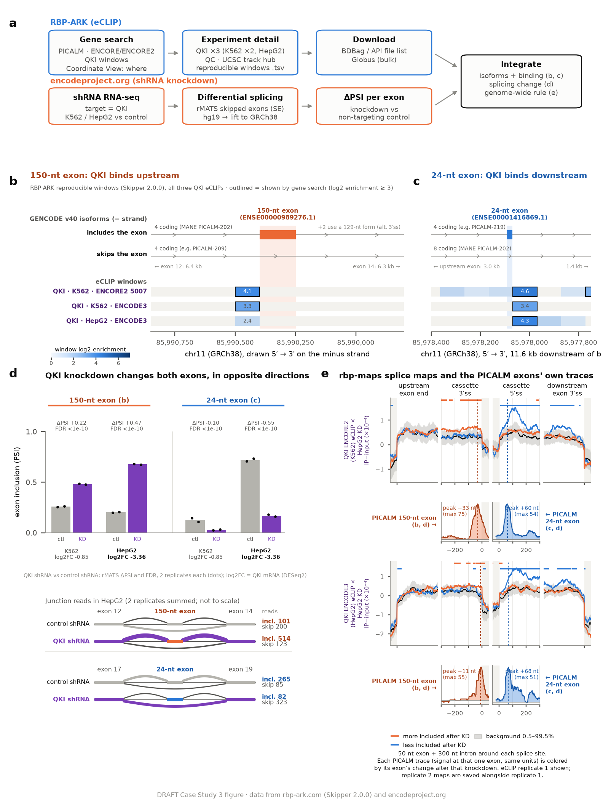

# ENCODE RBP Case Study 3: QKI and two PICALM exons

QKI regulates two cassette exons of PICALM, an Alzheimer's disease risk gene, in opposite directions. It binds just upstream of the 150-nt exon (ENSE00000989276.1) and represses it, and just downstream of the 24-nt exon (ENSE00001416869.1) and promotes it. The evidence comes from public data only: QKI eCLIP reprocessed with Skipper 2.0.0 on [RBP-ARK](https://rbp-ark.com), and ENCODE's QKI shRNA knockdown RNA-seq in K562 and HepG2.

## Reproduce the figure

There are three ways in, from quickest to most complete.

| Route | What it does | Where |
| --- | --- | --- |
| Redraw | Draws the figure from the small data files in this repository (numpy, pandas, matplotlib) | `data_and_code/picalm/`: `MAP_DIR=maps_stranded python make_fig.py` |
| Workflow notebooks | One notebook per box of panel a, from the RBP-ARK gene search to the integrated figure. Runs on free Google Colab with the bundled `lite_data/` (about an hour), or on all the data | [`notebooks/workflow/`](notebooks/workflow/README.md); on Colab: [open `00_colab_run_all.ipynb`](https://colab.research.google.com/github/yeolab/encode-rbp-case-study/blob/main/notebooks/workflow/00_colab_run_all.ipynb) |
| Full pipeline | The screen that chose PICALM, ENCODE BAM downloads, rMATS reruns, sashimi plots and rbp-maps splice maps (about 45 GB of downloads) | [`notebooks/`](notebooks/README.md) |

## Contents

| Folder | Contents |
| --- | --- |
| `manuscript/` | The case study text, figure legend and references (`case_study_QKI_PICALM.docx`) |
| `figures/` | The figure (`CS3_PICALM_QKI_draft.png`, `.pdf`), sashimi plots of both exons, and the data behind the panels |
| `data_and_code/picalm/` | `make_fig.py` and its inputs: PICALM windows and transcripts, knockdown statistics, and the splice-map lines |
| `notebooks/` | The full pipeline (00 to 05) and `cs3_utils.py` |
| `notebooks/workflow/` | The per-box workflow notebooks (01 to 07), their helpers, and `lite_data/` for free Colab |
| `results/` | Tables the notebooks write: the binding screen, knockdown statistics, event counts and PICALM's own eCLIP traces |
| `downloads/` | Scripts that fetch the eCLIP BAMs and build the event lists outside the notebooks |

Large files (BAMs, bigWigs, rMATS runs) are not stored here; the notebooks download or compute them into `data/` (ignored by git), or into the folder `CASE_STUDY_DATA` points to.

## Data sources

- RBP-ARK (Skipper 2.0.0): reproducible enriched windows and deduplicated eCLIP BAMs for QKI_K562_5007 (ENCORE2), QKI_K562_ENCSR366YOG and QKI_HepG2_ENCSR570WLM (ENCODE3).
- ENCODE: QKI shRNA knockdown RNA-seq (ENCSR256PLH, K562; ENCSR330YOU, HepG2) and non-target controls (ENCSR344XID, ENCSR603TCV), with ENCODE's rMATS and DESeq2 outputs.
- GENCODE v40 annotation throughout; rMATS-turbo 4.3.0 (`--libType fr-firststrand`) on the hg19 knockdown BAMs, lifted to GRCh38.

## License

Copyright © 2026 The Regents of the University of California. Free to copy, modify and distribute for educational, research and non-profit purposes; see [LICENSE](LICENSE). For commercial use, contact UC San Diego's Office of Innovation & Commercialization.
